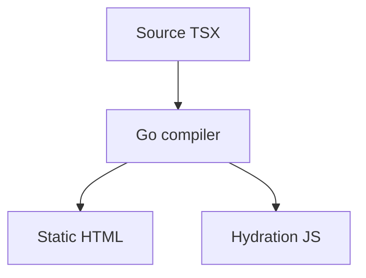

# Markdown & MDX

Content pages can be authored in Markdown (`.md`) or MDX (`.mdx`) - Markdown
with embedded JSX components. Both compile to static HTML at build time.

## Frontmatter

Each content page starts with YAML frontmatter:

```md
---
title: My Page
order: 2
sidebar: guides
keywords: [setup, install]
---

# Content starts here
```

| Key | Purpose |
|-----|---------|
| `title` | Page title (used in the sidebar and `<title>`) |
| `order` | Sort order within a directory (default `999`) |
| `sidebar` | Sidebar section override, or `[...]` JSON for a fully custom sidebar |
| `keywords` | Explicit search keywords for the search index |

Frontmatter is a small YAML subset: scalars, quoted strings (with the usual
`\n`, `\t`, `\uXXXX` escapes), `[a, b]` lists, nested maps, and block scalars
(`description: |` keeps line breaks, `description: >` folds them; `|-`/`>-`
strip the trailing newline). Anchors, aliases and tags are not supported.

## Markdown features

Markdown is parsed by [goldmark](https://github.com/yuin/goldmark), a
CommonMark implementation (the full CommonMark 0.31 example suite is part of
Krate's tests), with these extensions:

- **GFM** - tables, task lists, strikethrough, and `www.`/URL/email autolinks
- **Heading anchors** - every heading gets an `id` for deep-linking and the
  TOC. Ids are built from the heading's visible text (Unicode letters are kept,
  so `## Ünïcödé` and CJK headings work) and repeated headings get `-1`, `-2`
  suffixes.
- **Raw HTML** - HTML in a document is passed through as CommonMark specifies
  (`<kbd>`, `<details>`, `<span>`, ...). Markdown content is trusted project
  content; `javascript:`/`data:` link and image destinations are still
  removed.
- **Code fence info** - ```` ```ts title="app.ts" {1,3-5} ```` sets the language
  plus a `title` (shown in the code block header) and highlight line ranges
  (emitted as `data-highlight-lines` for your theme). `~~~` fences work too.
- **GFM alerts** - `> [!NOTE]`, `> [!TIP]`, `> [!IMPORTANT]`, `> [!WARNING]`
  and `> [!CAUTION]` render like the `:::note` admonitions.
- **Definition lists** - a term line followed by `: definition` lines
- **Footnotes** - `[^1]` references with `[^1]: text` definitions
- **Emoji shortcodes** - `:rocket:` -> rocket emoji (outside code spans)
- **Admonitions**

:::note
This is a note. Admonitions are enabled with `admonitions: true` in the
markdown config.
:::

:::warning
This is a warning callout.
:::

:::tip
Admonition types include `note`, `tip`, `warning`, and `danger`.
:::

- **Syntax highlighting** - fenced code blocks are highlighted at build time:

```tsx
export default function Hello() {
  return <h1>Hello, MDX!</h1>;
}
```

- **Math** - with `math: true`, `$inline$` and `$$display$$` spans are wrapped
  in `.krate-math` elements. In the docs plugin, KaTeX is loaded from a CDN and
  auto-renders them; elsewhere the spans are left for your own renderer/CSS.
  Code spans/blocks are never touched:

  ```text
  The identity $e^{i\pi} + 1 = 0$ is famous.

  $$\int_0^1 x\,dx = \tfrac{1}{2}$$
  ```

## Diagrams

With `mermaid: true`, fenced `mermaid` blocks render as diagrams:



## Component directives

Import a component, then wrap content in it with a `:::component` directive -
the body is rendered as Markdown and passed to the component as HTML:

```mdx
import { Card, Steps } from '@krate/components';

:::component Card title="Getting started"
Krate **compiles** Markdown into your components, with full Markdown inside.
:::
```

Directives are expanded to real component JSX at build time, so they appear in
the output as static HTML with no client runtime. This works for any imported
component (`:::component Steps`, `:::component Aside type="tip"`, ...).

### Built-in directives

Four container directives lower to `@krate/components` without any import (the
docs plugin auto-imports them):

- `:::card Title` ... `:::` - wraps the body in a `Card`.
- `:::steps` with nested `::step Title` items - a `Steps` list.
- `:::tabs` with nested `::tab Label` items - a `Tabs` panel.
- `:::code-group` with fenced code blocks - one tab per language.

```mdx
:::steps
::step Install
Run `npm install`.
::step Build
Run `krate build`.
:::
```

The `Tabs` (`Tabs.List`/`Tabs.Trigger`/`Tabs.Content`), `Steps` (`Steps.Step`), `Card`,
and `Code` components are imported automatically when their directive is used.

## MDX

MDX lets you embed JSX directly in your content. Beyond block-level
components, MDX files support:

- **ESM** - `import` and `export` blocks at the start of a line (a block ends
  at the next blank line) are hoisted into the page module, so
  `export const version = "1.2"` can be used by the rest of the file.
- **Inline JSX** - components inside paragraphs, with Markdown inside their
  children: `Status: <Badge>**beta**</Badge>`.
- **Expressions** - `{...}` in text and attributes. `{frontmatter.title}` and
  exported literal constants are resolved at build time (so they also work in
  headings and the search index); other expressions are emitted as runtime
  expressions. Escape a literal brace as `\{`.
- **Comments** - `{/* a comment */}` is dropped.

An unterminated `{` or an unsupported `export default` is a build error with
the file, line and column. Plain `.md` files do not treat braces specially.

The frontmatter `title` and `description` become the page's `<title>` and meta
description. Components can be used inline:

```mdx
# A page with a component

Here is a callout rendered from JSX:

<div class="callout">
  <strong>Heads up!</strong> You can mix Markdown and JSX in one file.
</div>
```

MDX files can also **import components**:

```mdx
import { Callout } from '../../components/callout';

<Callout type="tip">Imports work too.</Callout>
```

## Configuration

```typescript
markdown: {
  gfm: true,
  headingAnchors: true,
  admonitions: true,
  codeHighlight: true,
  math: false,
}
```

For how Markdown and MDX are parsed and compiled, see
[Contributing -> Architecture](/docs/contributing/architecture/).

## Content collections

`getCollection("name")` entries expose `html`, rendered with the same
renderer (highlighted code blocks, task lists, MDX expressions that resolve at
build time). Because `html` is a plain string, MDX components cannot render in
it: they are omitted and each one produces a warning with the file, line and
column. A collection entry that violates its schema, or an MDX syntax error,
fails the build (and `krate check`) instead of being skipped.

Collection data is folded into the page at build time and is never copied to
the browser: a page that only reads one entry ships none of the collection (or
its draft entries) in its JavaScript.
